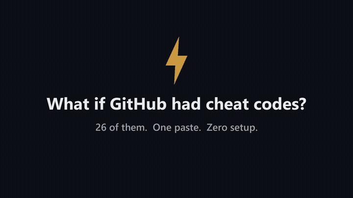
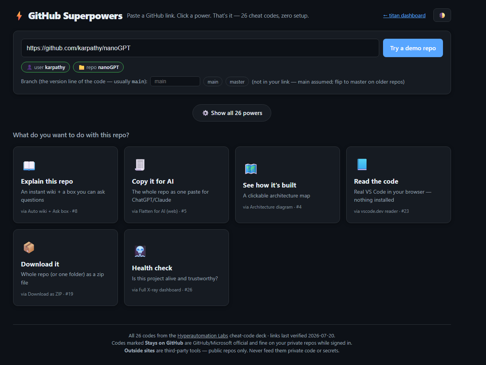
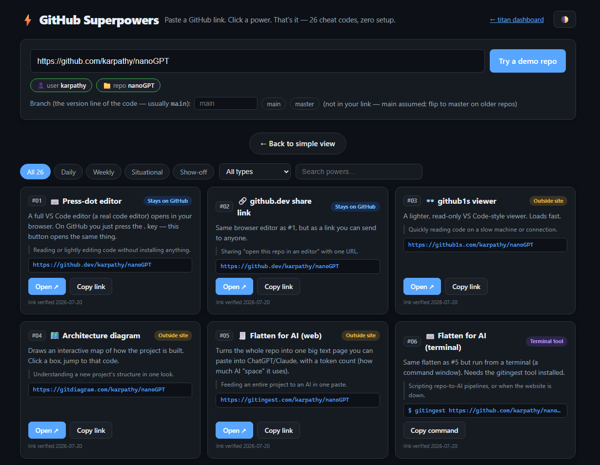
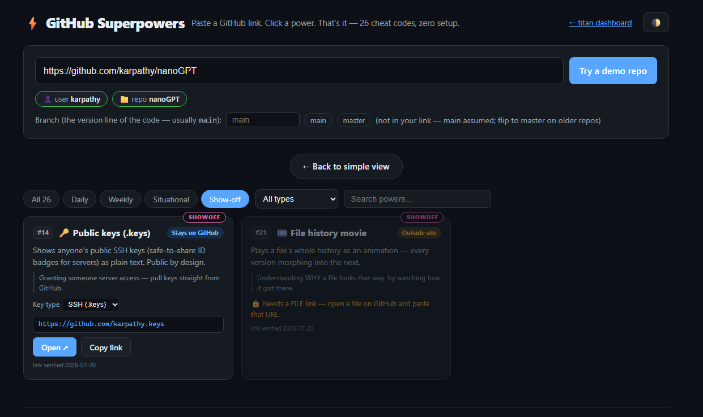
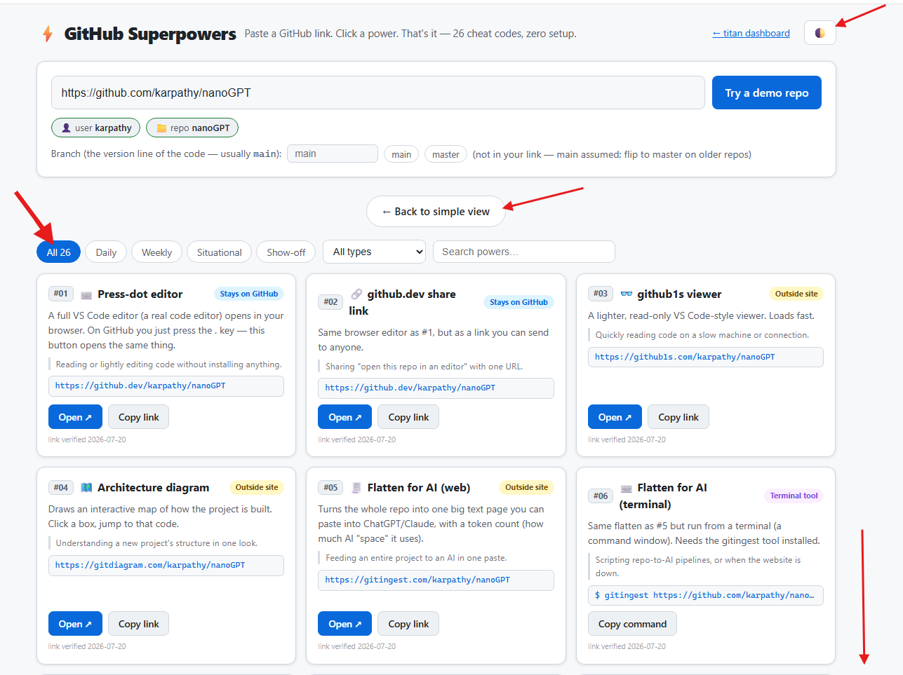
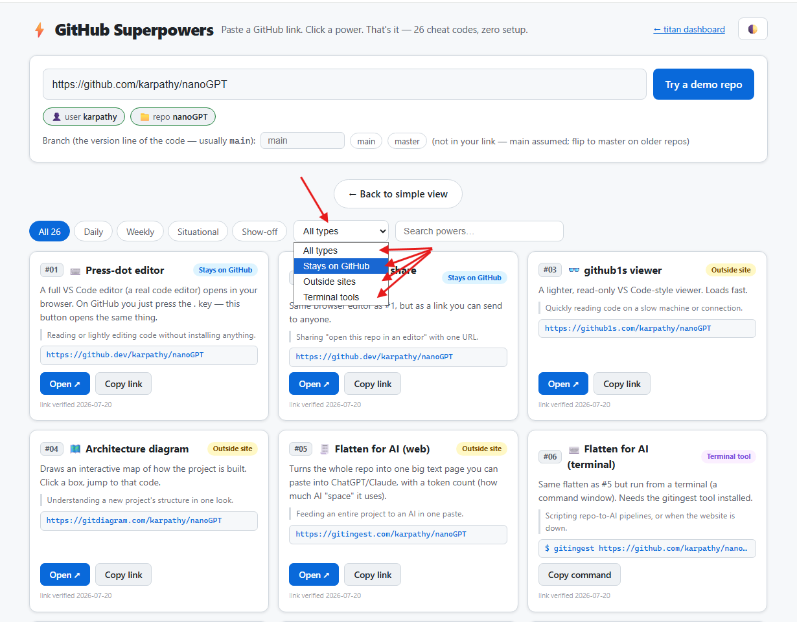
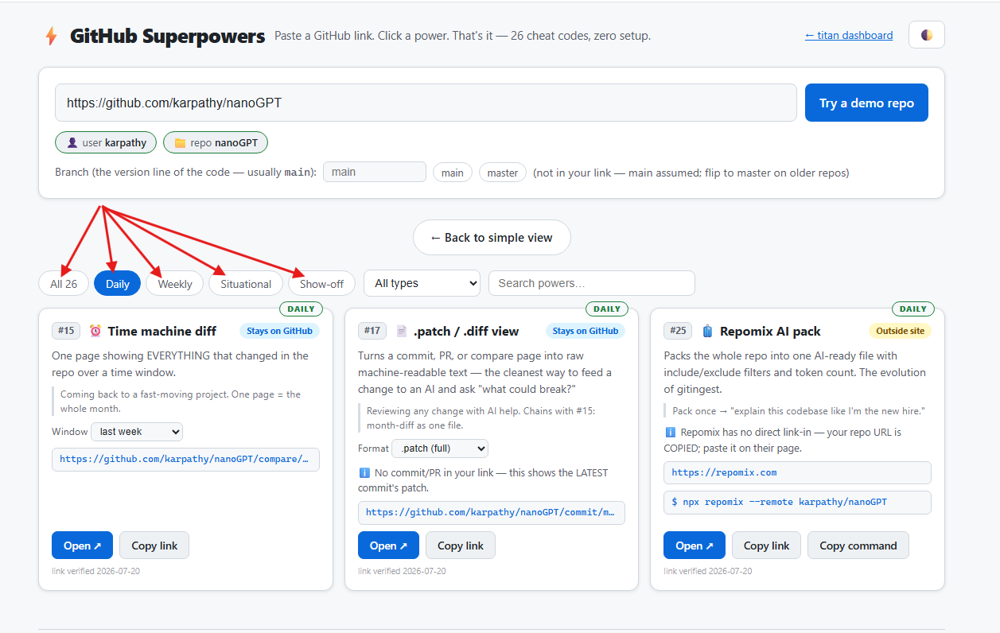
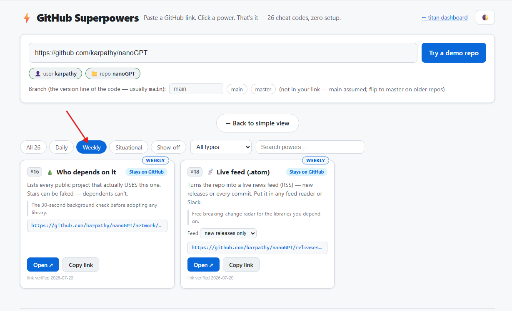
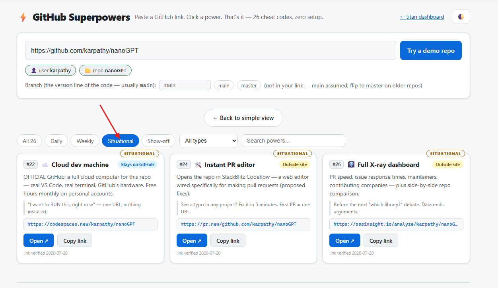
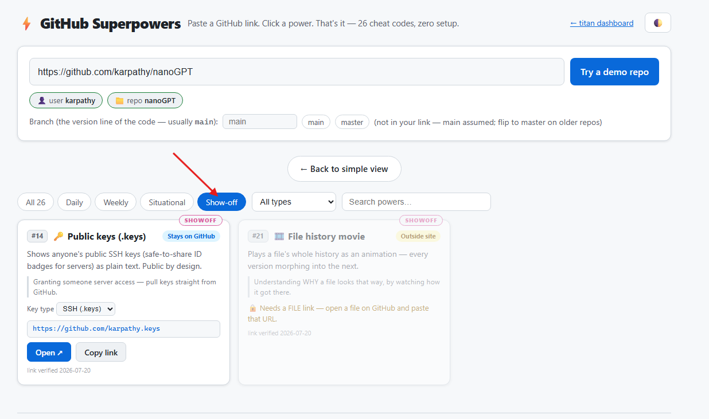

# ⚡ GitHub SuperPowers Dashboard

**26 GitHub cheat codes. One paste. Zero setup.**

Paste any GitHub repo link, click a power — instant repo wiki, AI-ready code dumps,
architecture maps, time-machine diffs, and 22 more. Built for everyone, not just
people who live in a terminal.

## ▶ Use it right now

**[Open the live dashboard](https://theindexaura.github.io/GitHubSuperPowersDashboard/)** — nothing to install.

Or go offline: download [`index.html`](index.html), double-click it. That's the entire app.
One file. No build, no dependencies, no account, no tracking.

🎬 [Watch the 33-second tour](media/commercial.mp4)

## What can it do?

| You want… | It opens… |
|---|---|
| 📖 "Explain this repo to me" | an instant wiki with an Ask box that cites real files |
| 🧾 "Feed this whole repo to ChatGPT/Claude" | the repo flattened into one paste, with token count |
| 🗺️ "Show me how it's built" | a clickable architecture map |
| ⏰ "What changed in the last month?" | one page with every change — the time machine |
| 🌲 "Who actually uses this library?" | real dependents (stars can be faked — these can't) |
| 📦 "Just give me the files" | the whole repo (or one folder) as a zip |

…and 20 more, organized by how often you'll actually use them:
**Daily · Weekly · Situational · Show-off**

## Two modes, one page

**Simple mode** — six big buttons, plain English:

**The full deck** — all 26 powers with tier tabs, filters, and search:

Buttons that don't fit your link lock themselves and tell you exactly what's missing:

## It keeps you honest about safety

- 🟢 **Stays on GitHub** — official GitHub/Microsoft codes, fine on your private repos while signed in
- 🟡 **Outside site** — third-party tools; the dashboard warns you before your first click, because
  **public repos only. Never feed private code or secrets to a tool you don't control.**

📚 <b>Guided tour (6 annotated screenshots)</b>

Switch to the full deck and back — the theme toggle lives top-right:

Filter powers by where they run:

Tier tabs — Daily is your muscle memory, the rest are your radar:

Show-off tier — pure joy, use tonight:

## Add power #27

Open `index.html`, find the `POWERS` array, copy any entry, edit five lines
(name, description, when-to-use, safety type, URL template). Test it with two
different repos. PRs welcome.

## Credit

All 26 codes were discovered and documented by
**[Hyperautomation Labs](https://www.youtube.com/watch?v=GINTfprgC7Y)** on YouTube —
this dashboard just turns their cheat-code deck into one-click buttons. Go subscribe.

Unofficial tool — not affiliated with GitHub. Third-party tools listed can change
or disappear; each card shows its last-verified date.

## License

[MIT](LICENSE) — do whatever makes you faster.
